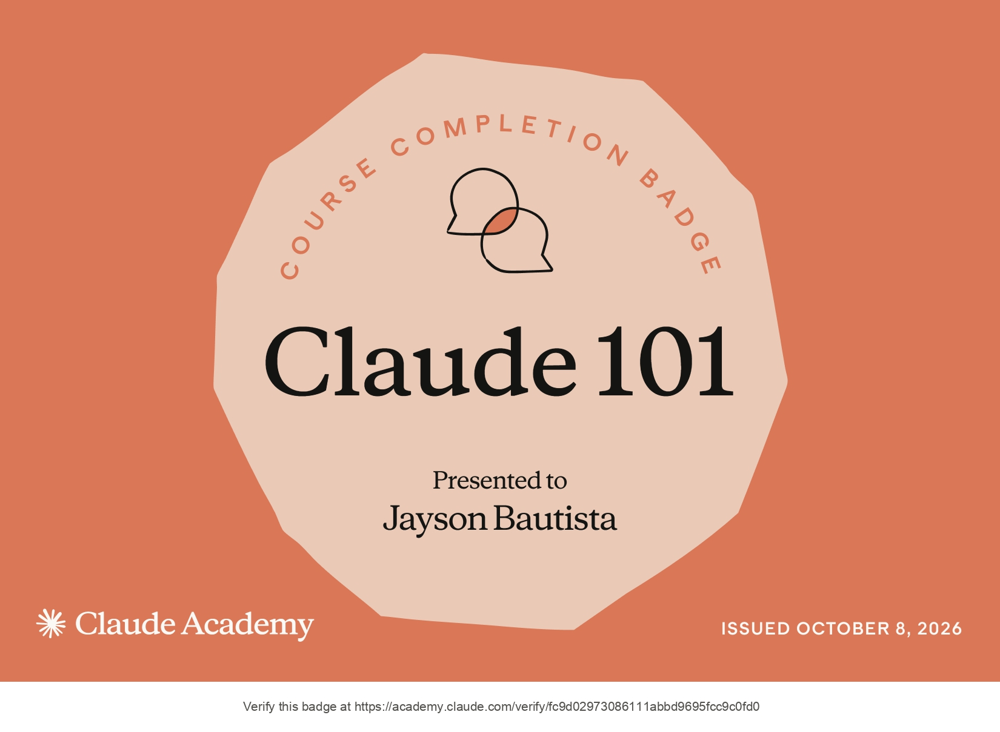
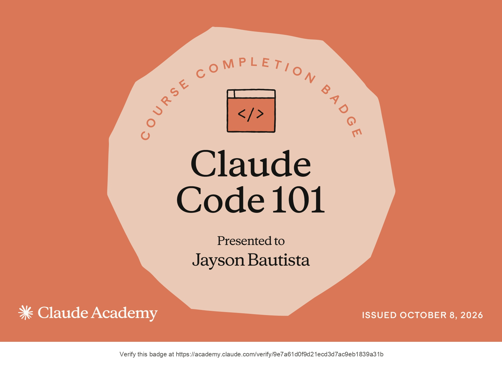
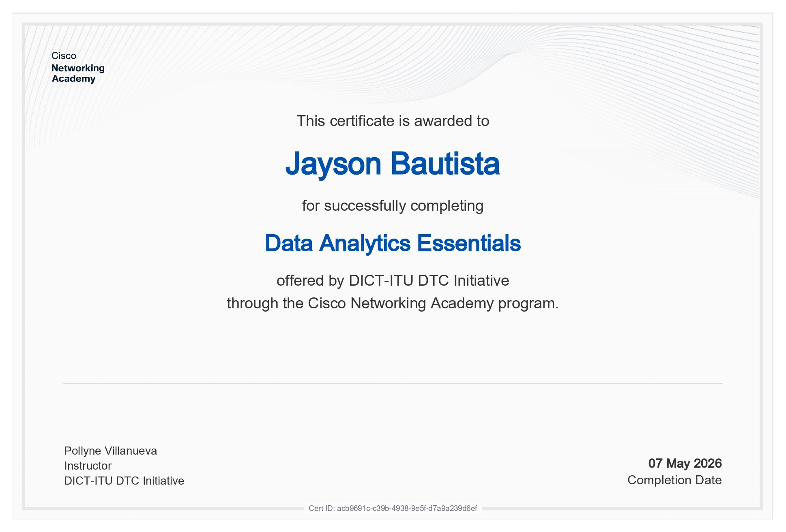
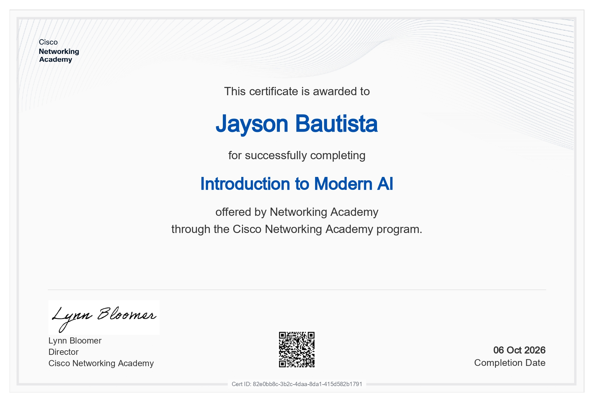
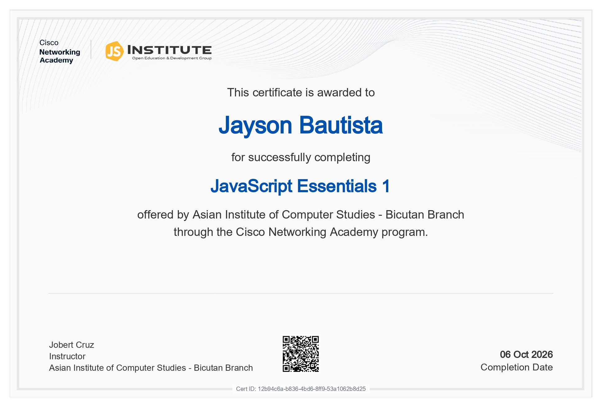
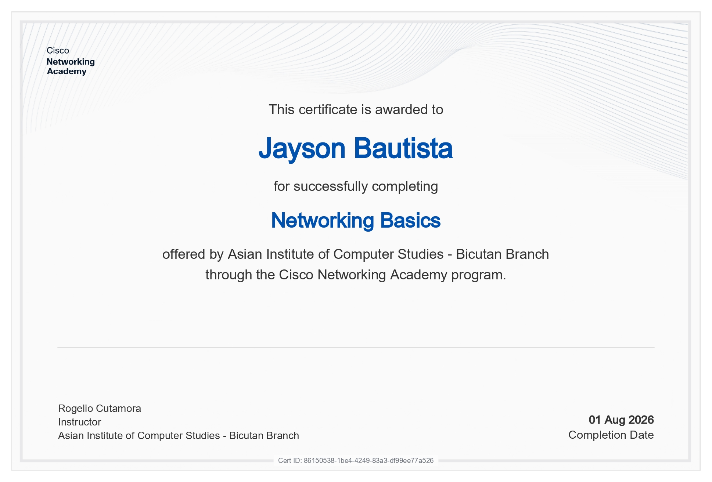
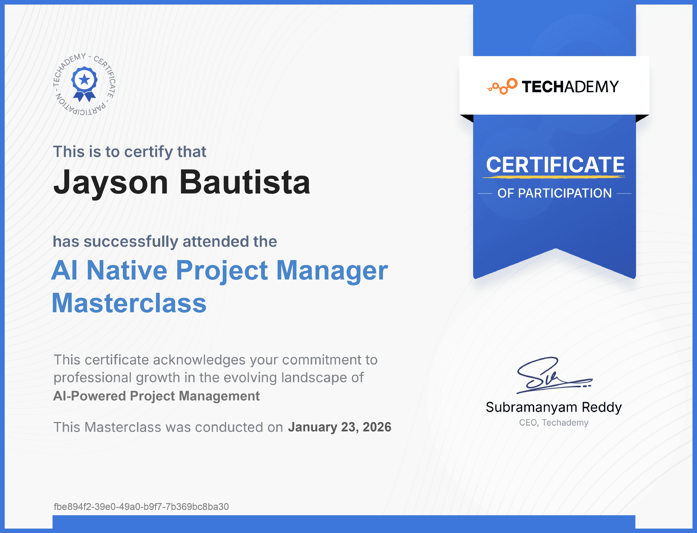
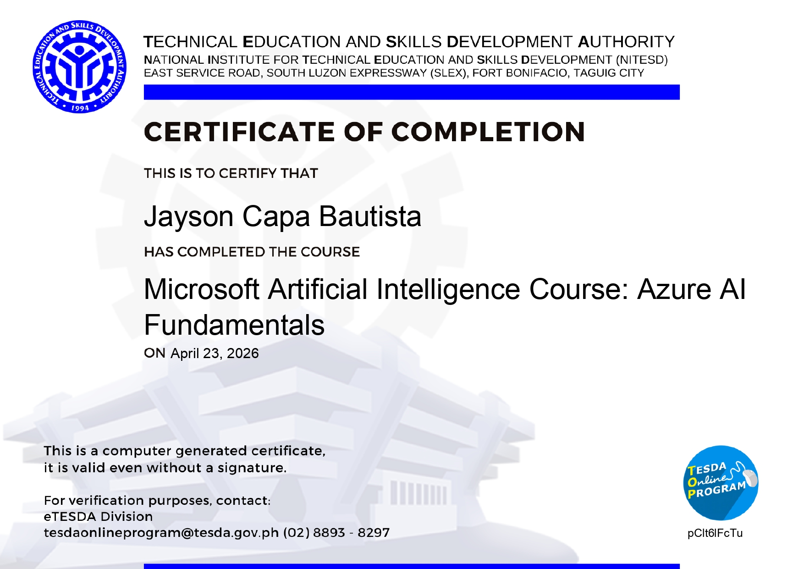
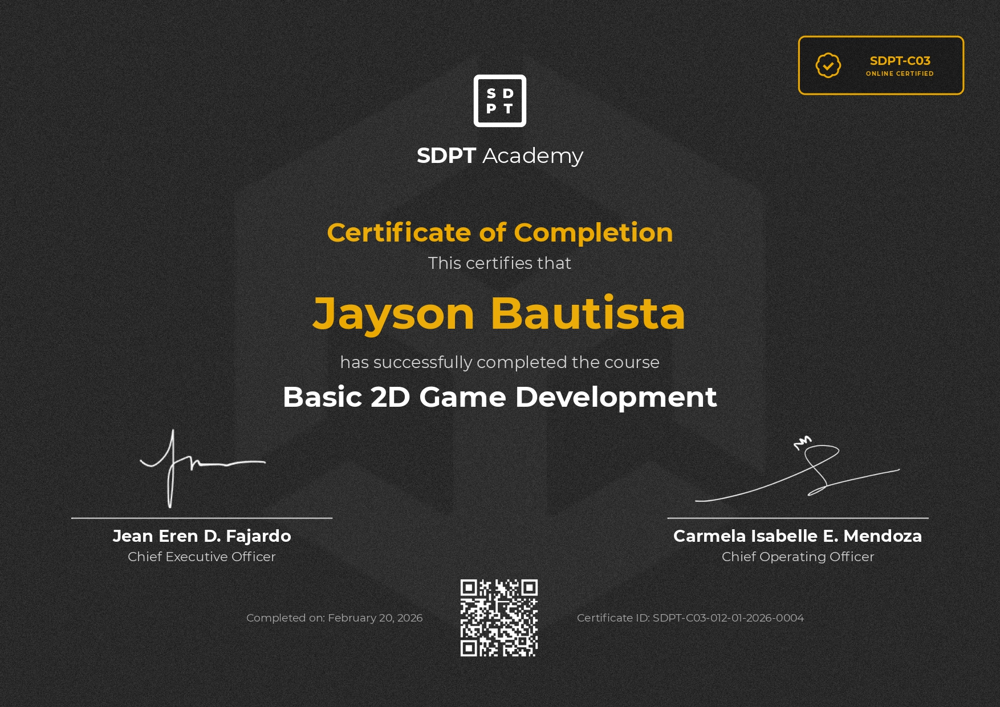
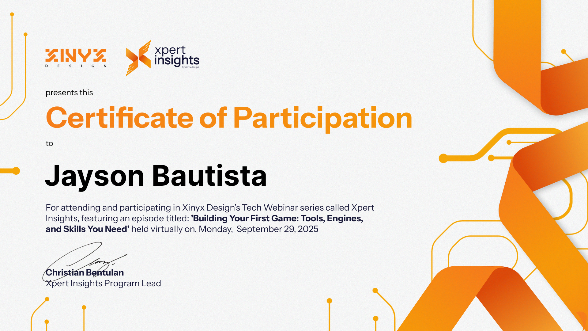

# Jayson Bautista

**Computer Science Student | Software Development | Game Development | AI & Automation**

📍 Philippines

I build software, interactive systems, and automated workflows, with hands-on experience in game programming, application development, and AI integrations.

My focus is on developing practical solutions, understanding the engineering principles behind them, and continuously expanding my technical capabilities through hands-on development.

---

### Areas of Focus

- **Software Engineering** — Application development, programming fundamentals, and system architecture
- **Game Development** — Gameplay systems, interactive mechanics, and game programming
- **AI & Automation** — Workflow automation, API integrations, and AI-powered applications
- **Web Development** — Responsive interfaces and functional web experiences

---

### 🛠️ Technologies & Tools

**Programming Languages**

**Game Development**

**Web Development**

**Development Tools**

**Other Technologies**

`n8n` · `REST APIs` · `AI Integrations` · `Workflow Automation` · `Google Sheets`

---

### 🏅 Certifications

  
  

  
  
  
  
  
  
  
  
  

---

### 📊 GitHub Statistics

  
  

---

### 🤝 Connect

Open to technical discussions, collaboration, and opportunities in software development, game development, and automation.

**GitHub:** [Krumasx6](https://github.com/Krumasx6)
